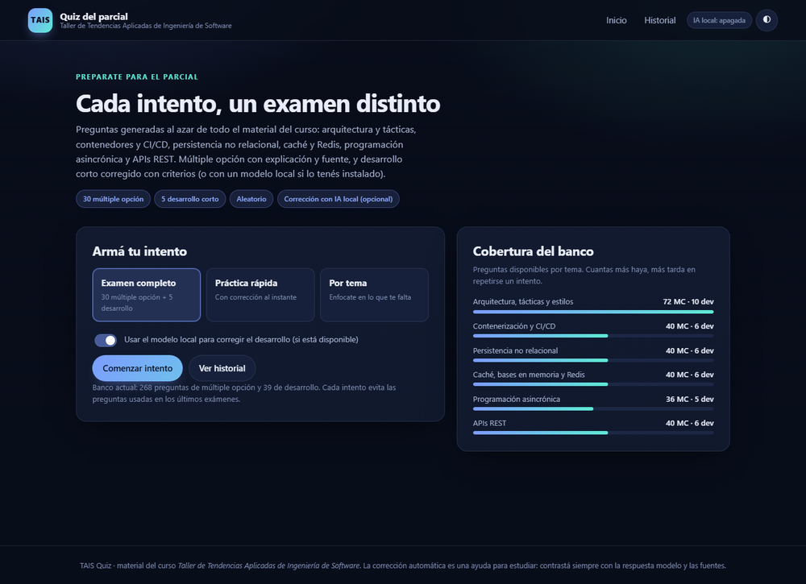
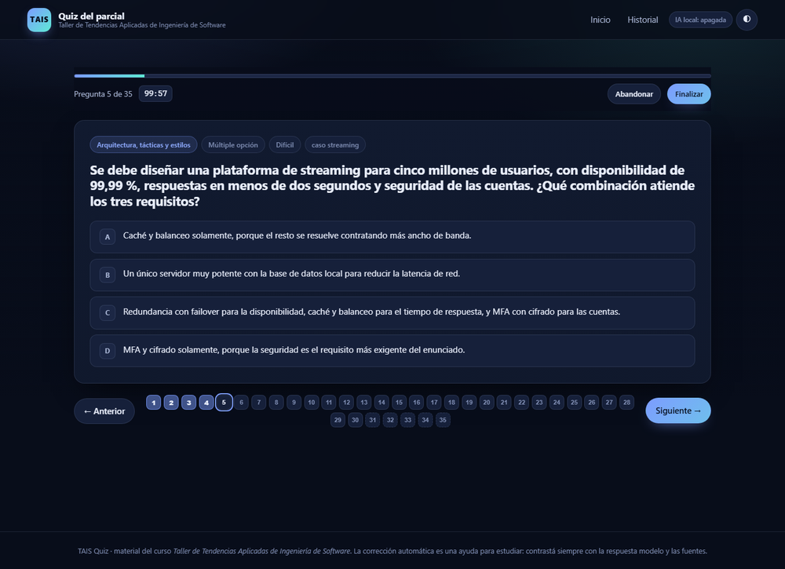
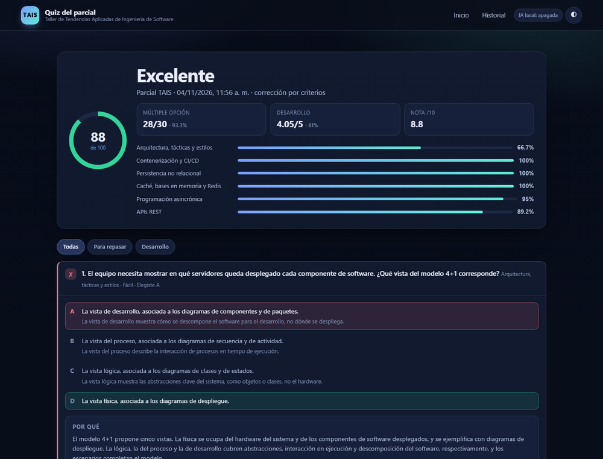
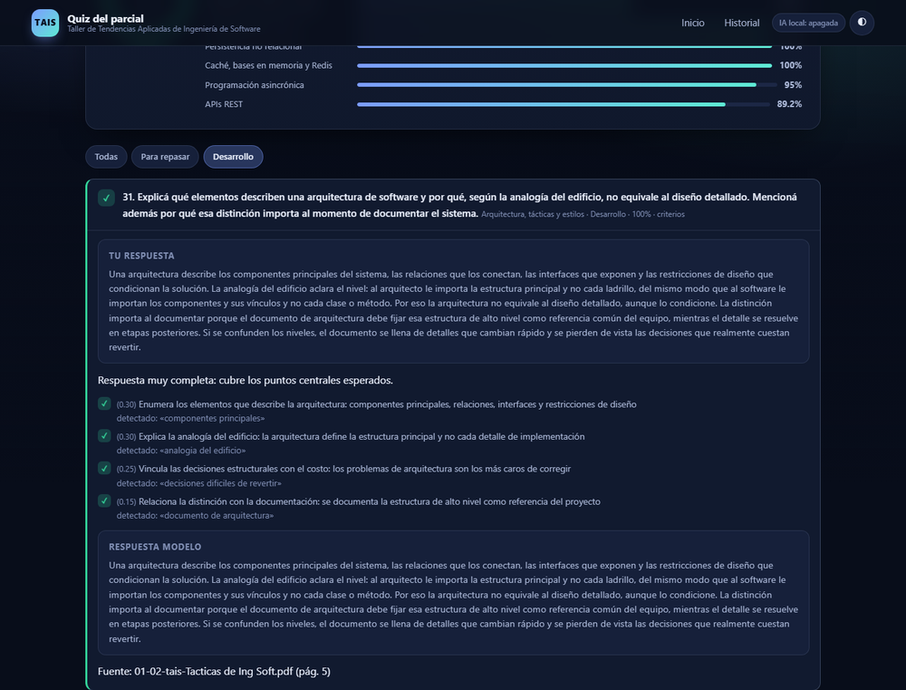

# TAIS Quiz — generador de exámenes del parcial

Herramienta de estudio para el **Taller de Tendencias Aplicadas de Ingeniería de Software**.
Genera exámenes **aleatorios** a partir del material real del curso (los PDF del repositorio) y
corrige las respuestas de desarrollo con criterios explícitos, con la opción de usar un
**modelo de lenguaje local** para una devolución más fina.

- **30 preguntas de múltiple opción** (5 por tema) con explicación de la correcta, por qué falla
  cada distractor y la página del PDF de donde sale.
- **5 preguntas de desarrollo corto** con rúbrica de criterios y respuesta modelo.
- Cada intento es distinto: se muestrean preguntas al azar evitando las usadas en exámenes
  anteriores y se mezcla el orden de las opciones.
- Funciona **sin internet y sin dependencias**: solo Python 3.9 o superior.

> La pregunta sobre la presentación «¿Qué aprendimos?» no está incluida, tal como se pidió.

---

## Capturas

| Inicio | Una pregunta del examen |
|:---:|:---:|
|  |  |
| **Resultado con el detalle por tema** | **Devolución de una respuesta de desarrollo** |
|  |  |

---

## Inicio rápido

```bash
python -m quiz servir
```

Se abre la interfaz en <http://127.0.0.1:8765>. Elegí el modo, respondé y corregí.
No hace falta instalar nada más.

En Windows también podés hacer doble clic en `iniciar.cmd`.

Si el puerto está ocupado: `python -m quiz servir --puerto 8766`.

**Para compartir con los alumnos:** [`docs/GUIA-ALUMNO.md`](docs/GUIA-ALUMNO.md) tiene el paso a paso
completo (requisitos, modos, IA opcional, problemas comunes y cómo aprovechar los intentos).

### Sin interfaz gráfica

```bash
python -m quiz examen                # examen completo interactivo en la terminal
python -m quiz examen --temas nosql  # examen de un solo tema
python -m quiz generar --seed 42     # examen imprimible en Markdown
python -m quiz estudiar --tema rest  # práctica con corrección inmediata
python -m quiz estadisticas          # cobertura del banco
```

`generar` guarda un Markdown listo para imprimir en `examenes/`. Con `--formato json` y
`--soluciones` sirve para compartir un examen con su corrección.

---

## Qué incluye

| Parte | Cantidad | Detalle |
|---|---|---|
| Múltiple opción | 30 | 5 por tema, 4 opciones, una correcta, explicación y fuente |
| Desarrollo corto | 5 | Un tema distinto cada una, rúbrica de 3–5 criterios ponderados |
| Banco total | 268 MC + 39 desarrollo | Rotación entre intentos para que no se repitan |

**Temas** (todos los del curso): arquitectura, tácticas y estilos · contenerización y CI/CD ·
persistencia no relacional · caché, bases en memoria y Redis · programación asincrónica · APIs REST.

Cada pregunta está anclada a una diapositiva concreta: la fuente aparece en la corrección como
`archivo.pdf (pág. N)`. Los criterios y palabras clave salen de la respuesta modelo, así que la
corrección automática es explicable y no una caja negra.

---

## Corrección de las respuestas de desarrollo

Hay dos modos, y la aplicación elige sola el mejor disponible:

1. **Por criterios (siempre funciona).** Compara la respuesta con los criterios de la rúbrica y
   sus palabras clave, sin distinguir acentos ni mayúsculas, tolerando sinónimos y variantes.
   Devuelve qué criterios se cubrieron, cuáles faltaron y el porcentaje. Es rápido y no necesita
   nada instalado.
2. **Con un modelo local (opcional).** Si hay un LLM accesible, evalúa el contenido con más
   tolerancia a redacciones libres. Si el modelo falla o no está, la corrección sigue con el modo
   anterior y la boleta lo aclara.

### Usar Ollama

```bash
# 1. Instalar Ollama desde https://ollama.com y bajar un modelo
ollama pull qwen2.5:7b-instruct

# 2. Arrancar el quiz: lo detecta solo en http://localhost:11434
python -m quiz servir
```

Modelos que funcionan bien para corregir en español (de menor a mayor calidad): `qwen2.5:3b-instruct`,
`llama3.1:8b`, `qwen2.5:7b-instruct`, `mistral-nemo`. Con 8 GB de RAM alcanza para los de 7–8B
cuantizados. La primera corrección puede tardar; después queda en caché del modelo.

### Usar LM Studio, llama.cpp, vLLM u otro servidor compatible con OpenAI

```bash
# .env en la raíz del proyecto
QUIZ_LLM_PROVEEDOR=openai
QUIZ_LLM_URL=http://localhost:1234/v1
QUIZ_LLM_MODELO=qwen2.5-7b-instruct
```

| Variable | Para qué | Ejemplo |
|---|---|---|
| `QUIZ_LLM_PROVEEDOR` | `auto` (detecta), `ollama`, `openai`, `ninguno` | `auto` |
| `QUIZ_LLM_URL` | URL base del servidor | `http://localhost:1234/v1` |
| `QUIZ_LLM_MODELO` | Nombre exacto del modelo | `qwen2.5:7b-instruct` |
| `QUIZ_LLM_API_KEY` | Solo si el servidor la pide | `sk-...` |
| `QUIZ_LLM_TIMEOUT` | Segundos de espera por corrección | `180` |
| `QUIZ_CORRECTOR` | Forzar `llm` o `heuristica` | `auto` |

En la interfaz, el estado se ve arriba a la derecha (`IA local: …`). El interruptor «Usar el
modelo local…» permite corregir sin IA aunque esté disponible. Todo se ejecuta en tu máquina:
la aplicación no envía datos a ningún servicio externo.

---

## Cómo se arma cada examen

- **Muestreo aleatorio con rotación.** Se eligen preguntas entre las menos usadas en intentos
  anteriores (`examenes/historial.json`), así el banco rota y no ves siempre lo mismo.
- **Opciones mezcladas** en cada pregunta: la respuesta correcta no queda siempre en el mismo lugar.
- **Semilla reproducible.** `--seed 42` (o el campo de semilla en la API) genera siempre el mismo
  examen; sin semilla se usa entropía del sistema.
- **Puntaje.** 60 % múltiple opción + 40 % desarrollo, expresado en nota /100 y /10. Si el examen
  tiene solo una de las dos partes, los pesos se renormalizan.
- **Guardado.** Cada corrección queda en `examenes/` como JSON y como boleta Markdown descargable.

---

## Estructura del repositorio

```
.
├── 0*.pdf, Practicos/, Laboratorios/   Material del curso (fuente de las preguntas)
├── quiz/                               Aplicación (sin dependencias)
│   ├── bank.py        Modelo y validación del banco
│   ├── sampler.py     Generación aleatoria y rotación de preguntas
│   ├── grader.py      Corrección con criterios y con LLM
│   ├── llm.py         Cliente de Ollama / servidores compatibles con OpenAI
│   ├── cli.py         Comandos de terminal
│   ├── web.py         Servidor HTTP local y API
│   ├── export.py      Examen y boleta en Markdown
│   └── util.py        Rutas, texto, JSON y consola
├── web/                                Interfaz (HTML + CSS + JS, sin frameworks)
├── content/
│   ├── bank/mc/*.json                  268 preguntas de múltiple opción
│   ├── bank/short/*.json               39 preguntas de desarrollo
│   ├── corpus/*.json                   Texto extraído de los PDF (para citar y buscar)
│   └── exam_spec.json                  Composición del examen
├── scripts/
│   ├── validate_bank.py                Valida el banco contra el esquema
│   └── extract_corpus.py               Regenera content/corpus desde los PDF (opcional)
├── tests/                              78 tests (unittest, sin dependencias)
├── docs/GUIA-ALUMNO.md                 Paso a paso para quien va a practicar
├── docs/GUIA-AUTORIA.md                Cómo escribir preguntas nuevas
├── docs/COMO-FUNCIONA.md               Diseño interno (muestreo, corrección, API)
├── examenes/                           Tus intentos y boletas (se crea al usar la app)
├── iniciar.cmd / iniciar.sh            Atajo para levantar la interfaz
├── Dockerfile / docker-compose.yml     Para correrlo en contenedor
└── README.md
```

### API local

La interfaz consume una API JSON mínima; también sirve para automatizar:

| Método | Ruta | Qué hace |
|---|---|---|
| `GET` | `/api/estado` | Versión, cobertura del banco, estado del modelo local |
| `POST` | `/api/examen` | Genera un examen (`{modo, seed, temas, mc_por_tema, desarrollo}`) |
| `POST` | `/api/corregir` | Corrige (`{examen_id, mc, desarrollo, usar_llm}`) |
| `POST` | `/api/corregir-desarrollo` | Corrige una respuesta suelta (modo práctica) |
| `GET` | `/api/historial` | Intentos guardados |
| `GET` | `/api/examen/<id>/boleta` | Boleta Markdown |

Ejemplo:

```bash
curl -s http://127.0.0.1:8765/api/examen -H "Content-Type: application/json" \
  -d '{"modo":"examen","seed":7}' | head -c 400
```

---

## Agregar o editar preguntas

1. Leé [`docs/GUIA-AUTORIA.md`](docs/GUIA-AUTORIA.md) (esquema JSON y criterios de calidad).
2. Escribí el archivo en `content/bank/mc/` o `content/bank/short/` (se pueden tener varios
   archivos por tema; el motor los mezcla).
3. Validá:

```bash
python scripts/validate_bank.py                    # esquema, ids, duplicados
python scripts/validate_bank.py --estricto-paginas  # además verifica las páginas citadas
```

4. Corré los tests: `python -m unittest discover -s tests -t . -v`.

El validador exige: 4 opciones con una sola correcta, `porque_no` en cada distractor, explicación,
fuente con un PDF real del repositorio y página dentro de rango; en desarrollo, criterios con pesos
que suman 1, palabras clave y respuesta modelo.

---

## Tests

```bash
python -m unittest discover -s tests -t . -v
```

78 tests que cubren el esquema del banco, la aleatoriedad y reproducibilidad del examen, la
rotación de preguntas, la corrección heurística y con modelo simulado, el parser de JSON del LLM,
la exportación a Markdown y la API HTTP completa (incluida la protección de rutas estáticas).

---

## Docker

```bash
docker build -t tais-quiz .
docker run --rm -p 8765:8765 -v "$PWD/examenes:/app/examenes" tais-quiz
```

Con modelo local:

```bash
docker compose up quiz                  # solo la app
docker compose --profile ia up quiz     # app + Ollama (después: docker compose exec ollama ollama pull qwen2.5:7b-instruct)
```

---

## Preguntas frecuentes

**¿Necesito internet?** No. Todo es local: Python estándar, archivos del repo y, si querés IA, un
modelo que corre en tu máquina.

**No aparece la IA local.** Revisá que Ollama/LM Studio esté corriendo y que el modelo exista con el
nombre configurado. En la interfaz, pasá el mouse por el badge `IA local` para ver el detalle. La
corrección por criterios sigue funcionando igual.

**Quiero practicar un tema puntual.** Modo «Por tema» en la interfaz, o `python -m quiz examen --temas cache`.

**¿Se repiten las preguntas entre intentos?** El muestreo prioriza las menos usadas, así que la
repetición baja mucho; con 268 preguntas y 30 por examen hay margen para 7 exámenes completos sin
repetir ninguna.

**Una respuesta desarrollada me quedó corta.** El criterio es explícito: 5 a 10 líneas, cubriendo
los puntos de la consigna. La corrección automática es orientativa; siempre está la respuesta
modelo y la fuente para contrastar.

**La consola muestra mal los acentos en Windows.** Ejecutá `chcp 65001` o usá Windows Terminal.
La interfaz web no tiene ese problema.

**¿Se puede compartir?** Sí: es un repositorio autocontenido. Quien lo descargue solo necesita
Python 3.9+ y ejecutar `python -m quiz servir`.

---

## Uso responsable

Es una herramienta para **estudiar**: intentos ilimitados, corrección explicada y acceso a las
fuentes. No está pensada para usarse durante el parcial. La corrección automática ayuda a detectar
qué falta, pero la referencia final es siempre el material de la cátedra.

Los PDF incluidos son material del curso y pertenecen a sus autores. El código se distribuye con
licencia MIT (ver [`LICENSE`](LICENSE)).
